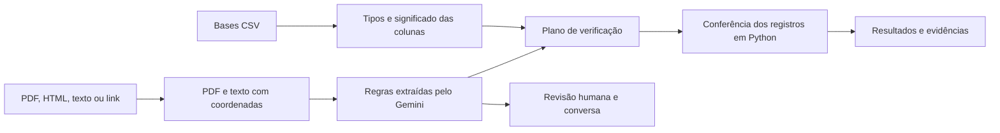

# IC Grifo

O Grifo ajuda a estudar documentos normativos, como contratos, editais e regulamentos.
Ele extrai regras, liga cada uma ao trecho original do documento e verifica seu
cumprimento em bases CSV. A pessoa pode revisar as regras e conversar sobre o documento.

## Comece pela documentação

| Quero entender | Onde ler |
| --- | --- |
| Por onde começar a estudar o código | [Roteiro de leitura](docs/roteiro-de-leitura.md) |
| Como as partes se conectam | [Arquitetura e modelo de dados](docs/arquitetura.md) |
| O caminho de cada operação, com fluxogramas | [Fluxos do sistema](docs/fluxos.md) |
| O papel de cada arquivo do servidor | [Mapa do backend](docs/backend.md) |
| O papel de cada arquivo da interface | [Mapa do frontend](docs/frontend.md) |
| Como uma regra vira uma verificação | [Validação explicada com exemplos](docs/validacao.md) |
| Quais endpoints existem e quem os chama | [Referência da API](docs/api.md) |
| Como executar, configurar e investigar erros | [Desenvolvimento e operação](docs/desenvolvimento.md) |

O [índice da documentação](docs/README.md) também organiza a leitura por perguntas.

## Visão rápida



Há três conceitos diferentes: **revisão humana** da regra extraída, **busca** dos
registros aos quais ela se aplica e **validação** do cumprimento nesses registros.
A documentação usa esses nomes de maneira consistente.

## Organização

- [backend/](backend/README.md): API FastAPI, serviços Python, modelos, migrations e testes.
- [frontend/](frontend/README.md): interface Next.js, componentes React e cliente da API.
- [scripts/dev-backend.mjs](scripts/dev-backend.mjs): preparação e inicialização da API em desenvolvimento.
- [docs/](docs/README.md): material para estudar o projeto.

## Executar localmente

Primeiro prepare as dependências e os arquivos de ambiente seguindo o
[guia de desenvolvimento](docs/desenvolvimento.md). Depois, na raiz:

```powershell
npm run dev
```

O comando inicia a API e a interface. O script da API sobe o PostgreSQL quando a
configuração usa banco local e aplica as migrations antes de iniciar o servidor.

- Interface: http://localhost:3000
- API: http://localhost:8000/api/v1
- Contrato OpenAPI: http://localhost:8000/openapi.json
- Documentação interativa: http://localhost:8000/docs

## Estágio atual

O Assistente usa a API real para documentos, CSVs, regras, buscas, validações e conversa.
A tela **Base de regras**, em `/regras`, ainda usa dados de demonstração e busca local
por palavras. A estrutura de embeddings existe no banco, mas não há busca semântica
ativa nessa tela.

Resultados inconclusivos são parte do funcionamento: uma regra sem evidência
suficiente nos CSVs não recebe uma aprovação automática. Os limites e os significados
de cada resultado estão no [guia de validação](docs/validacao.md).
