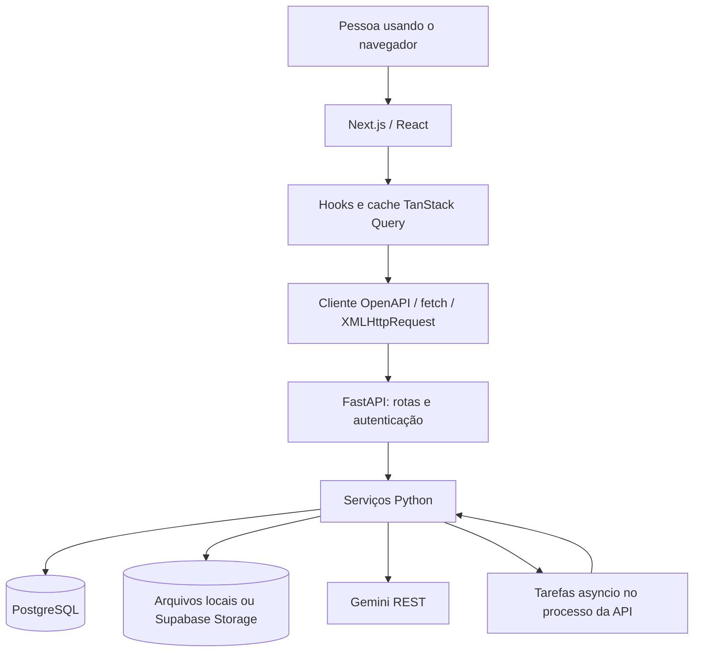
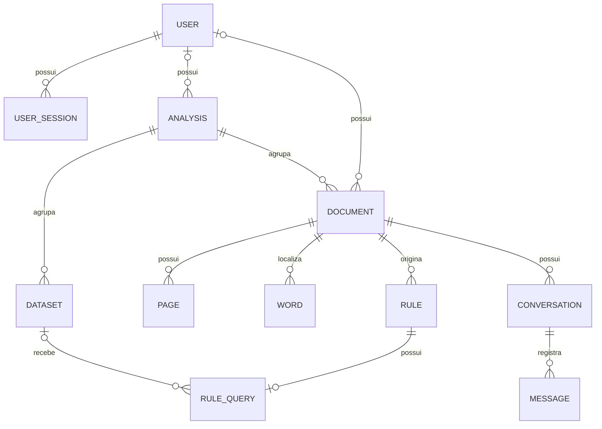

# Arquitetura e modelo de dados

[Índice](README.md) · [Fluxos](fluxos.md) · [Mapa do backend](backend.md) · [Mapa do frontend](frontend.md)

## O problema que o projeto resolve

Um documento descreve obrigações, proibições, prazos e condições. Uma base de dados
contém fatos: datas, valores, categorias e situações. O Grifo liga esses dois mundos,
mantendo a regra ligada à fonte e tornando explícito quando faltam fatos para concluir
a verificação.

A aplicação tem uma interface Next.js e uma API FastAPI separadas. O navegador chama
a API por HTTP; não acessa diretamente o PostgreSQL nem o Storage.

## Vocabulário

| Conceito | Significado no projeto |
| --- | --- |
| Análise, `Analysis` | Agrupa documentos e bases CSV pertencentes a uma pessoa. |
| Base, `Dataset` | Arquivo CSV, schema físico e interpretação semântica das colunas. |
| Documento, `Document` | Fonte normativa convertida para uma representação comum em PDF. |
| Página e palavra, `Page` e `Word` | Estrutura visual que liga texto e coordenadas. |
| Regra, `Rule` | Trecho normativo, tipo, resumo, origem e situação da revisão humana. |
| Busca, `RuleQuery` | Filtro estruturado que encontra os registros relacionados a uma regra. |
| Plano, `ValidationPlan` | Escopo e critérios de cumprimento propostos pela IA. |
| Resultado, `RuleValidationOut` | Conclusão e contagens calculadas sobre os registros. |
| Evidência, `ValidationRecord` | Resultado de uma linha com os valores e a explicação da comparação. |
| Conversa e mensagem | Histórico associado a um documento específico. |

`ValidationPlan` e `RuleValidationOut` são modelos de contrato em Python. Não são
tabelas próprias: plano e resultado ficam no campo JSONB `Rule.validation`.

## Relações no banco

A definição atual está em [models.py](../backend/app/db/models.py). As migrations
mostram como a estrutura evoluiu, não apenas como ela está hoje.

O usuário de análises e documentos antigos pode ser nulo por compatibilidade de
migração; as rotas atuais criam esses recursos com proprietário. O banco permite várias
conversas por documento, mas o fluxo normal reutiliza uma conversa.

Algumas ligações são listas ou JSON, e não chaves estrangeiras: `Rule.dataset_ids`,
`Message.rule_ids` e os dados internos de `Rule.validation`. Não espere encontrar
uma tabela de associação para cada uma delas.

## Onde cada informação fica

| Local | Informações |
| --- | --- |
| PostgreSQL | Usuários, hashes de sessão, análises, metadados de bases, texto dos documentos, páginas, palavras, regras, buscas, validações e mensagens. |
| Storage | PDFs e CSVs; os nomes são derivados dos UUIDs. |
| Memória da API | Tarefas em execução e cache de bases carregadas e tipadas. |
| Cache do navegador | Dados consultados pela interface, arquivos PDF temporariamente reutilizados e estados de requisição. |
| localStorage | Preferências de aparência e de disposição dos painéis. |

Os registros completos do CSV não viram uma tabela SQL. O motor lê o arquivo e filtra
as linhas em Python. `Dataset.columns` guarda tipos, exemplos e significados; não é
uma cópia de todas as linhas. O cache do servidor não substitui o Storage.

## Quatro responsabilidades relacionadas à IA

1. `llm.extract_rules`: recebe texto dividido em frases e encontra regras.
2. `llm.generate_queries`: propõe filtros para localizar registros.
3. `validation_llm.interpret_columns` e `plan_rules`: interpretam colunas e propõem verificações.
4. `llm.stream_chat`: responde sobre o documento e suas regras.

O motor de conformidade não pede à IA uma decisão para cada linha. Ele valida o plano
e calcula as comparações. A qualidade da interpretação normativa e semântica continua
dependendo da IA e da revisão humana.

## Fronteiras importantes

- As rotas verificam entrada, sessão e propriedade. Os serviços contêm o processamento.
- Pydantic define os contratos da API e dos planos; SQLAlchemy define a persistência.
- `ingest.py` coordena as etapas. `compliance.py` calcula resultados sem acessar o banco.
- `query_engine.py` valida filtros e carrega bases. Não executa SQL ou código da IA.
- Os conversores entregam sempre PDF, texto e posições de palavras, independentemente da origem.
- A autenticação é própria: token aleatório em cookie, hash no banco e senha com scrypt.
  A opção de Supabase para banco e arquivos não torna o login um fluxo de Supabase Auth.

## Estados não são intercambiáveis

| Campo | Exemplos | Responde a qual pergunta? |
| --- | --- | --- |
| `Document.status` | `processing`, `extracting_rules`, `ready`, `error` | A tarefa terminou? |
| `Dataset.status` | `processing`, `ready`, `error` | O CSV já pode ser lido? |
| `Rule.status` | `pendente`, `validada`, `rejeitada` | A pessoa aprovou a regra extraída? |
| `RuleQuery.state` | `pendente`, `ok`, `erro` | O filtro foi executado corretamente? |
| `Rule.validation.status` | `conforme`, `violacao`, `inconclusiva` | Há evidência de cumprimento nos registros? |

`ready` não significa que todas as regras são conformes. `Rule.status = validada`
também não significa que os registros cumprem a regra.

## Estruturas e comentários que podem confundir a leitura

- `/regras` usa dados de exemplo e correspondência local de palavras. Não é uma consulta
  agregada real dos documentos do usuário.
- Há vetor e índice de embeddings em `Rule`, mas não há serviço ativo de embeddings
  ou busca vetorial usado pela tela.
- `RuleQuery.verdict` e `verdict_details` são campos reservados do fluxo antigo.
  A verificação atual usa `Rule.validation`.
- `Document.mode` admite `knowledge_base`, mas as rotas atuais de criação usam `assistant`.
- Comentários citam `app.core.offsets` e uma descrição da API menciona UTF-16.
  Esse módulo não existe neste checkout. A extração usa posições Python no texto; a
  interface recebe os grifos normalizados e cria regras por página e trecho selecionado.
- Arquivos em `.next/` são artefatos gerados, inclusive alguns já versionados na raiz.
  Eles não são o ponto de partida para estudar a implementação.
- O compose de produção ainda cita Anthropic, enquanto o cliente de IA usa Gemini.
  Veja o [guia de desenvolvimento](desenvolvimento.md) antes de usar esse deploy.

## Execução em segundo plano

As tarefas são criadas com `asyncio.create_task` e mantidas em um conjunto no próprio
processo da API. Não há fila externa nem worker independente. O entrypoint de produção
inicia um worker Uvicorn; replicar processos sem adaptar essa coordenação muda as
garantias do fluxo.

As fontes têm uma assinatura baseada em situação, tamanho e metadados. Mudanças nas
bases ou no significado das colunas invalidam conclusões anteriores. Pedidos
concorrentes de validação são agrupados para permitir uma nova avaliação após a
chegada de bases. O [fluxo de recuperação](fluxos.md) explica os reinícios.
