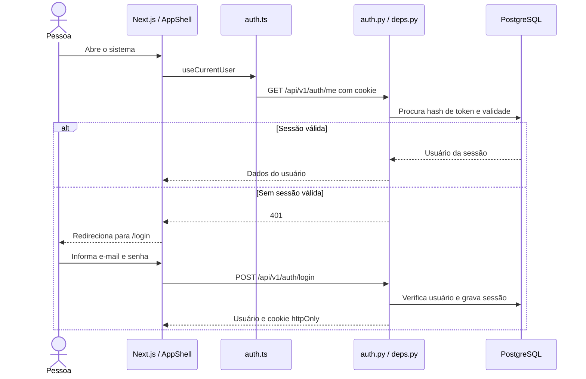
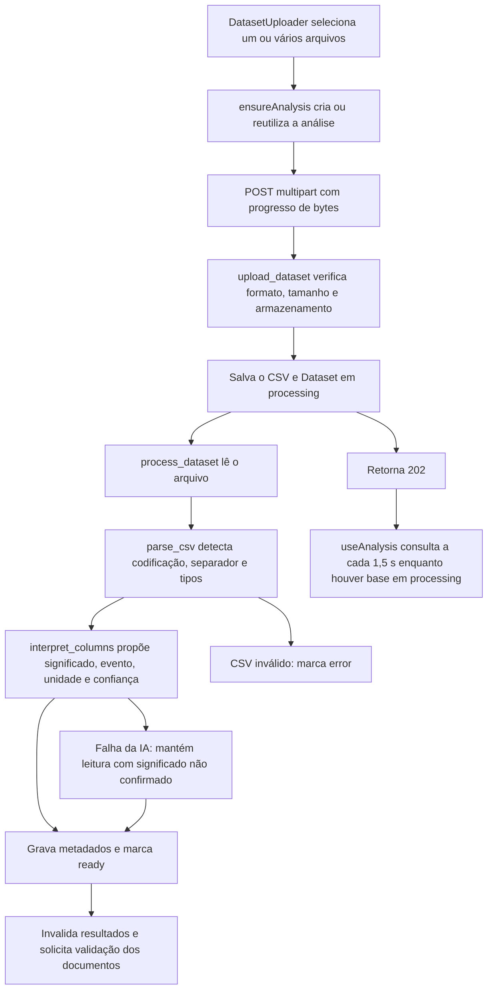
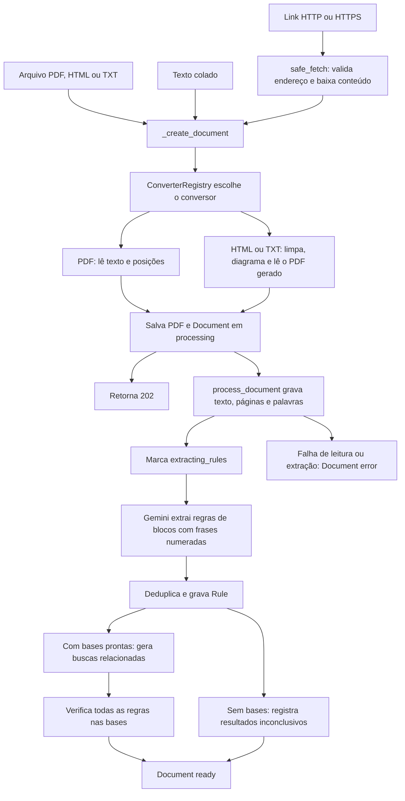
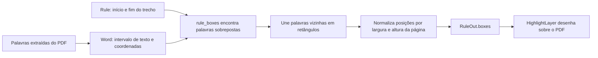
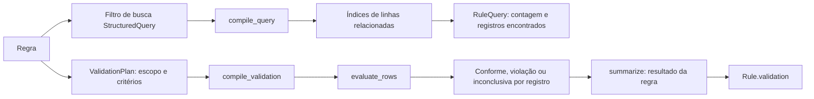
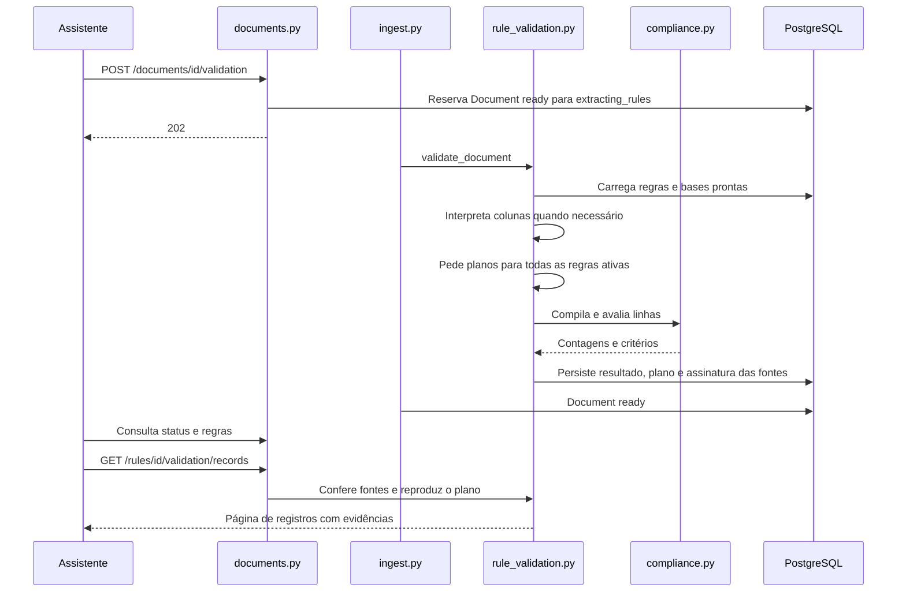
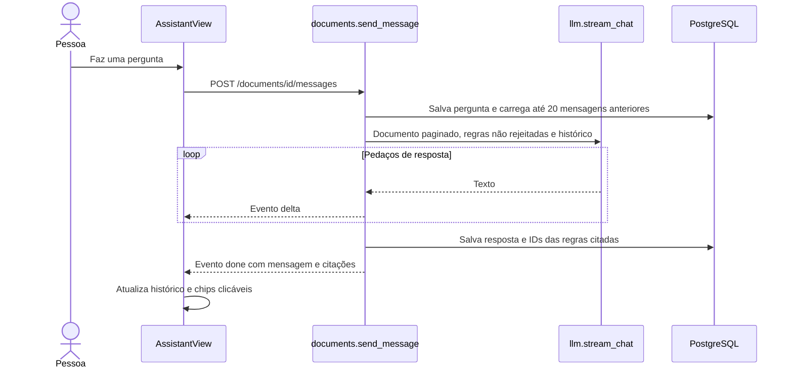
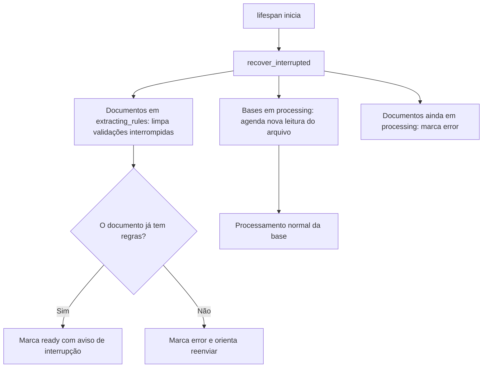

# Fluxos do sistema

[Índice](README.md) · [Arquitetura](arquitetura.md) · [API](api.md)

Cada diagrama mostra uma operação. Os nomes em código na explicação são os pontos
para abrir no editor. Respostas 202 indicam que uma tarefa continua após a requisição.

## 1. Entrada e autenticação

O cadastro também inicia uma sessão. O logout remove a sessão atual e limpa o cookie.
A troca de senha encerra outras sessões. A proteção dos recursos acontece em
[deps.py](../backend/app/api/deps.py) e nas funções `owned_analysis`,
`_owned_document` e `_owned_rule`, além do redirecionamento visual de `AppShell`.

## 2. Envio de CSV e interpretação das colunas

O progresso do envio não é o progresso da leitura no servidor.
[client.ts](../frontend/src/lib/api/client.ts) usa XMLHttpRequest para medir os bytes;
[analyses.ts](../frontend/src/lib/analyses.ts) acompanha o processamento por consultas.

O caminho do backend é `upload_dataset` →
`storage.save_file` → `ingest.start_dataset_processing` →
`process_dataset` → `rule_validation.interpret`.

O CSV pode ser cortado na última quebra de linha que cabe no limite do armazenamento.
O tamanho original é preservado para identificar essa cobertura parcial. A presença
de uma coluna semanticamente ambígua não torna o CSV ilegível, mas impede conclusões
que dependam dela.

## 3. Entrada e processamento de documentos

A conversão acontece antes de devolver 202. A extração de regras e as etapas seguintes
continuam em segundo plano. Um PDF sem texto é recusado: o projeto não executa OCR.

Arquivos centrais:
[documents.py](../backend/app/api/v1/documents.py),
[registry.py](../backend/app/services/converters/registry.py),
[pdf_text.py](../backend/app/services/pdf_text.py),
[ingest.py](../backend/app/services/ingest.py) e
[llm.py](../backend/app/services/llm.py).

Os blocos de texto têm sobreposição para não perder regras na fronteira.
A IA devolve números de frases; o backend encontra os intervalos exatos no texto.
O chat e as tabelas passam a usar as regras persistidas.

## 4. Como o grifo aparece na página

O visualizador usa pdf.js para desenhar páginas e sua camada de texto. O backend usa
PyMuPDF para extrair palavras. Como os grifos são frações da página, continuam ligados
ao trecho ao mudar o zoom.

Na criação manual, o navegador envia página, trecho e resumo. `create_rule` usa
`page_range` e `find_excerpt` para localizar o texto no servidor; não aceita apenas
um retângulo visual como prova da existência de uma regra.

## 5. Busca de registros e validação de cumprimento

A busca responde **quais registros estão relacionados**. A validação responde
**se esses registros cumprem a regra**. Uma busca que executou com `state = ok`
não comprova conformidade.

A geração automática inicial de buscas considera as regras ligadas a bases na
extração. O comando manual de gerar buscas pode considerar as demais regras não
rejeitadas. Buscas manuais são preservadas.

A validação considera todas as regras extraídas; regras rejeitadas são registradas
como ignoradas. Regras sem dados verificáveis recebem um resultado explicativo.
O [exemplo completo](validacao.md) mostra os dois caminhos para a mesma obrigação.

## 6. Revalidar, alterar bases e carregar evidências

Os prefixos omitidos apenas nos rótulos desse diagrama são `/api/v1`.
As fontes são verificadas novamente antes de servir evidências. Base removida ou
significado alterado exige nova verificação.

Se uma base termina de carregar enquanto outra avaliação está em execução,
`_validation_requested` registra um pedido pendente. Ao terminar, o documento
pode iniciar outra rodada com as fontes atualizadas.

## 7. Conversa com resposta em streaming

Esse chat usa o documento aberto. Não executa uma busca semântica global nem recebe
automaticamente todas as linhas dos CSVs ou o relatório completo de conformidade.
Falhas podem chegar por evento `error` depois que a conexão SSE já foi aberta.

## 8. Reinício da API

A recuperação não representa uma fila durável de tarefas. Ela usa os estados
persistidos para decidir o que pode ser retomado e o que exige uma nova ação.
