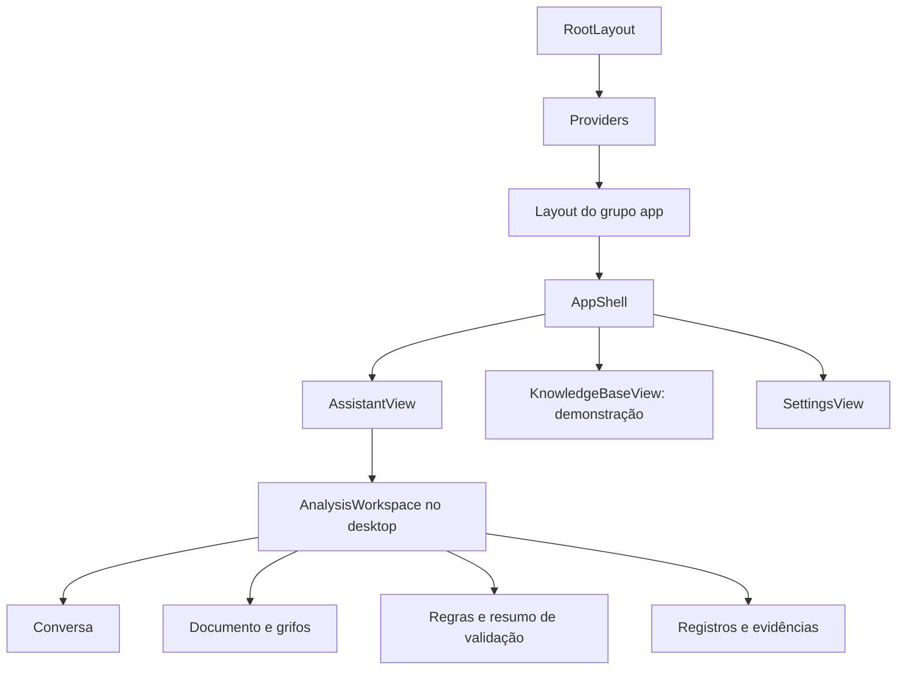

# Mapa do frontend

[Índice](README.md) · [Arquitetura](arquitetura.md) · [Fluxos](fluxos.md)

As rotas ficam em `src/app`; os componentes em `src/components`; os hooks e o cliente
da API em `src/lib`. O alias `@/` aponta para `src/`.

## Árvore de composição principal

No celular, o Assistente usa abas em vez dos painéis redimensionáveis.

## Estado, consultas e atualização

| Informação | Dono principal | Exemplo |
| --- | --- | --- |
| Dados da API | TanStack Query em `lib/` | Regras e análise. |
| Interação temporária | Estado de `AssistantView` | Seleção, filtros, pergunta e aba móvel. |
| Streaming | Estado temporário e depois histórico da API | Pedaços de resposta até o evento final. |
| Preferências | Hooks de persistência e tema | Painéis, larguras e aparência. |
| Grifo | Coordenadas da API renderizadas na interface | O navegador desenha as marcações. |

`useAnalysis` consulta a cada 1,5 segundo enquanto há base em processamento.
`useDocument` consulta a cada 1,5 segundo durante processamento e a cada 5 segundos
quando pronto; para no erro. `useRules` acompanha regras habilitadas a cada 5 segundos.
A transição para pronto invalida os caches de regras, análise e evidências.

O envio de CSV usa XMLHttpRequest para medir bytes. O chat usa fetch e leitura de SSE
porque a operação precisa de POST. Consultas comuns usam o cliente OpenAPI tipado.

## Roteiro dentro de AssistantView

1. `ensureAnalysis`, `openFiles` e `openDocument`: criação e seleção do contexto.
2. Hooks `useAnalysis`, `useDocument`, `useRules` e `useMessages`: dados remotos.
3. `send`: pergunta e resposta temporária.
4. `goToRule`, seleção e pesquisa: sincronização de documento e tabelas.
5. `chatPanel`, `documentPanel`, `rulesPanel` e `tablePanel`: composição das áreas.
6. Diálogos finais: bases, editor de busca e criação manual de regra.

## Rotas e composição

| Arquivo | Responsabilidade e pontos de entrada |
| --- | --- |
| [src/app/layout.tsx](<../frontend/src/app/layout.tsx>) | Layout raiz, idioma, Geist, metadados, tema inicial e Providers. |
| [src/app/providers.tsx](<../frontend/src/app/providers.tsx>) | Disponibiliza QueryClient e ToastProvider; configura cache, tentativas e comportamento de foco. |
| [src/app/page.tsx](<../frontend/src/app/page.tsx>) | Redireciona / para /assistente. |
| [src/app/globals.css](<../frontend/src/app/globals.css>) | Estilos globais, tokens, temas e integração Tailwind. |
| [src/app/(app)/layout.tsx](<../frontend/src/app/(app)/layout.tsx>) | Envolve as telas principais em AppShell; o grupo entre parênteses não faz parte da URL. |
| [src/app/(app)/assistente/page.tsx](<../frontend/src/app/(app)/assistente/page.tsx>) | Metadados de /assistente e montagem de AssistantView. |
| [src/app/(app)/regras/page.tsx](<../frontend/src/app/(app)/regras/page.tsx>) | Rota /regras com KnowledgeBaseView demonstrativa. |
| [src/app/(app)/configuracoes/page.tsx](<../frontend/src/app/(app)/configuracoes/page.tsx>) | Rota /configuracoes com SettingsView. |
| [src/app/(auth)/layout.tsx](<../frontend/src/app/(auth)/layout.tsx>) | Composição visual das telas de login/cadastro e controle de tema. |
| [src/app/(auth)/login/page.tsx](<../frontend/src/app/(auth)/login/page.tsx>) | Monta o formulário de login. |
| [src/app/(auth)/cadastro/page.tsx](<../frontend/src/app/(auth)/cadastro/page.tsx>) | Monta o formulário de cadastro. |
| [src/app/dev/ui/page.tsx](<../frontend/src/app/dev/ui/page.tsx>) | Entrada da galeria /dev/ui. |
| [src/app/dev/ui/ui-demo.tsx](<../frontend/src/app/dev/ui/ui-demo.tsx>) | Galeria visual de componentes; usa SystemDemo. |
| [src/app/dev/ui/system-demo.tsx](<../frontend/src/app/dev/ui/system-demo.tsx>) | Demonstrações locais de telas, conversa, envio e estados; não executa o processamento real. |
| [src/app/opengraph-image.tsx](<../frontend/src/app/opengraph-image.tsx>) | Gera imagem de compartilhamento usando logo e fontes locais. |

## Estrutura, autenticação e configurações

| Arquivo | Responsabilidade e pontos de entrada |
| --- | --- |
| [src/components/app/app-shell.tsx](<../frontend/src/components/app/app-shell.tsx>) | Consulta a sessão, redireciona ao login e organiza sidebar, cabeçalho e navegação móvel. |
| [src/components/app/app-header.tsx](<../frontend/src/components/app/app-header.tsx>) | Cabeçalho da seção e controles de navegação/tema. |
| [src/components/app/app-sidebar.tsx](<../frontend/src/components/app/app-sidebar.tsx>) | Navegação, usuário, configurações e saída. |
| [src/components/app/nav.ts](<../frontend/src/components/app/nav.ts>) | Rotas, rótulos e identificação da seção atual. |
| [src/components/app/use-sign-out.ts](<../frontend/src/components/app/use-sign-out.ts>) | Coordena logout e navegação. |
| [src/components/auth/login-form.tsx](<../frontend/src/components/auth/login-form.tsx>) | Login, erros e redirecionamento next; reconhece sessão existente. |
| [src/components/auth/register-form.tsx](<../frontend/src/components/auth/register-form.tsx>) | Cadastro, validação de formulário, erros e navegação após criar a conta. |
| [src/components/settings/settings-view.tsx](<../frontend/src/components/settings/settings-view.tsx>) | Perfil/senha via API, aparência, sessão e status do servidor. |
| [src/components/api-status.tsx](<../frontend/src/components/api-status.tsx>) | Consulta health e apresenta a disponibilidade da API/banco. |
| [src/components/brand-logo.tsx](<../frontend/src/components/brand-logo.tsx>) | Identidade visual reutilizável. |
| [src/components/theme-toggle.tsx](<../frontend/src/components/theme-toggle.tsx>) | Controle de alternância do tema. |

## Assistente, envio e conversa

| Arquivo | Responsabilidade e pontos de entrada |
| --- | --- |
| [src/components/assistant/assistant-view.tsx](<../frontend/src/components/assistant/assistant-view.tsx>) | Coordena a tela real: análise/documento, envio, conversa, seleção, PDF, filtros, painéis e validação. |
| [src/components/assistant/assistant-composer.tsx](<../frontend/src/components/assistant/assistant-composer.tsx>) | Campo de pergunta, anexos e aviso do Assistente real. |
| [src/components/analysis/analysis-workspace.tsx](<../frontend/src/components/analysis/analysis-workspace.tsx>) | Painéis redimensionáveis e PanelToggles; persiste visibilidade e larguras. |
| [src/components/datasets/dataset-uploader.tsx](<../frontend/src/components/datasets/dataset-uploader.tsx>) | Envio paralelo de CSVs, progresso, estado de leitura, remoção e significado das colunas. |
| [src/components/documents/document-source-dialog.tsx](<../frontend/src/components/documents/document-source-dialog.tsx>) | Entrada por texto ou link; garante análise e chama os hooks de criação. |
| [src/components/chat/chat-message.tsx](<../frontend/src/components/chat/chat-message.tsx>) | Mensagens, streaming e chips de regras citadas. |
| [src/components/chat/processing-steps.tsx](<../frontend/src/components/chat/processing-steps.tsx>) | Etapas e falhas do processamento de documento. |
| [src/components/chat/chat-composer.tsx](<../frontend/src/components/chat/chat-composer.tsx>) | Compositor usado pela demonstração SystemDemo; o Assistente real usa AssistantComposer. |
| [src/components/chat/upload-dropzone.tsx](<../frontend/src/components/chat/upload-dropzone.tsx>) | Área demonstrativa de envio em SystemDemo; não é a entrada real do Assistente. |

## Documento, grifos e pesquisa

| Arquivo | Responsabilidade e pontos de entrada |
| --- | --- |
| [src/components/document/pdf-document.tsx](<../frontend/src/components/document/pdf-document.tsx>) | Carrega pdf.js/worker, dimensões, canvas e camada de texto; adia desenho de páginas distantes. |
| [src/components/document/pdf-viewer.tsx](<../frontend/src/components/document/pdf-viewer.tsx>) | Estrutura de rolagem, cabeçalho, sobreposições e páginas; não lê o formato PDF. |
| [src/components/document/pdf-toolbar.tsx](<../frontend/src/components/document/pdf-toolbar.tsx>) | Zoom, identificação da página e ações do visualizador. |
| [src/components/document/highlight-layer.tsx](<../frontend/src/components/document/highlight-layer.tsx>) | Desenha grifos, regra ativa e retângulos de pesquisa normalizados. |
| [src/components/document/create-rule-popover.tsx](<../frontend/src/components/document/create-rule-popover.tsx>) | Formulário de regra manual ancorado na seleção de texto. |
| [src/components/document/rule-legend.tsx](<../frontend/src/components/document/rule-legend.tsx>) | Legenda de tipos e controle do filtro por tipo. |
| [src/components/document/search-bar.tsx](<../frontend/src/components/document/search-bar.tsx>) | Entrada e navegação das ocorrências da busca no PDF. |
| [src/components/document/use-pdf-search.ts](<../frontend/src/components/document/use-pdf-search.ts>) | Obtém texto do PDF e retângulos das ocorrências para pesquisa visual. |

## Regras, filtros e conformidade

| Arquivo | Responsabilidade e pontos de entrada |
| --- | --- |
| [src/components/rules/rules-table.tsx](<../frontend/src/components/rules/rules-table.tsx>) | Tabela com seleção, hover, revisão humana, busca e coluna opcional de validação. |
| [src/components/rules/rules-header.tsx](<../frontend/src/components/rules/rules-header.tsx>) | Contagens, filtros, avisos e ações da lista. |
| [src/components/rules/rule-chip.tsx](<../frontend/src/components/rules/rule-chip.tsx>) | Citação clicável que conecta mensagem e destaque de regra. |
| [src/components/rules/types.ts](<../frontend/src/components/rules/types.ts>) | Tipos mínimos usados pelos componentes de regras. |
| [src/components/queries/query-badge.tsx](<../frontend/src/components/queries/query-badge.tsx>) | Estado/contagem da busca e acesso ao editor. |
| [src/components/queries/query-editor-dialog.tsx](<../frontend/src/components/queries/query-editor-dialog.tsx>) | Editor por formulário ou JSON; converte valores e envia o filtro ao backend. |
| [src/components/records/records-panel.tsx](<../frontend/src/components/records/records-panel.tsx>) | Visão geral de regras e alternância entre evidências da validação e registros da busca. |
| [src/components/validation/validation-badge.tsx](<../frontend/src/components/validation/validation-badge.tsx>) | Rótulo do resultado e ValidationSummary com contagens gerais. |
| [src/components/validation/validation-details.tsx](<../frontend/src/components/validation/validation-details.tsx>) | Explicação, dados faltantes, data e tabela de evidências paginada por base/resultado. |
| [src/components/knowledge/knowledge-base-view.tsx](<../frontend/src/components/knowledge/knowledge-base-view.tsx>) | Demonstração /regras, com dados fixos, busca por palavras e revisão em estado local. |
| [src/components/knowledge/answer-card.tsx](<../frontend/src/components/knowledge/answer-card.tsx>) | Resposta com citações da tela demonstrativa. |
| [src/components/knowledge/question-bar.tsx](<../frontend/src/components/knowledge/question-bar.tsx>) | Pergunta da tela demonstrativa. |

## Hooks e utilitários

| Arquivo | Responsabilidade e pontos de entrada |
| --- | --- |
| [src/lib/api/client.ts](<../frontend/src/lib/api/client.ts>) | openapi-fetch com cookies, unwrap, apiUrl e XMLHttpRequest para multipart com progresso. |
| [src/lib/api/errors.ts](<../frontend/src/lib/api/errors.ts>) | ApiError/errorMessage padronizam falhas HTTP, de rede e respostas inesperadas. |
| [src/lib/api/index.ts](<../frontend/src/lib/api/index.ts>) | Exportações públicas do cliente e dos tipos da API. |
| [src/lib/api/schema.d.ts](<../frontend/src/lib/api/schema.d.ts>) | Tipos gerados do OpenAPI. Atualizar com gen:api, nunca à mão. |
| [src/lib/auth.ts](<../frontend/src/lib/auth.ts>) | Sessão, login/cadastro/logout, perfil/senha, validação de next e formatação do nome. |
| [src/lib/analyses.ts](<../frontend/src/lib/analyses.ts>) | Consultas de análises, criação, upload/remoção de CSVs e polling das bases em processamento. |
| [src/lib/documents.ts](<../frontend/src/lib/documents.ts>) | Documentos/PDF, regras, histórico, atualização otimista da revisão e leitura de SSE. |
| [src/lib/queries.ts](<../frontend/src/lib/queries.ts>) | Operadores, descrição de filtros, geração/edição/execução de buscas e paginação de registros. |
| [src/lib/validation.ts](<../frontend/src/lib/validation.ts>) | Rótulos, comando de revalidação e consulta das evidências. |
| [src/lib/theme.ts](<../frontend/src/lib/theme.ts>) | Leitura, aplicação e persistência do tema e preferência do sistema. |
| [src/lib/use-persistent-state.ts](<../frontend/src/lib/use-persistent-state.ts>) | Estado React validado em localStorage e armazenamento dos painéis. |
| [src/lib/use-media-query.ts](<../frontend/src/lib/use-media-query.ts>) | Hook responsivo e distinção entre desktop e móvel. |
| [src/lib/floating.ts](<../frontend/src/lib/floating.ts>) | Posicionamento de elementos flutuantes ancorados em elementos ou seleções. |
| [src/lib/utils.ts](<../frontend/src/lib/utils.ts>) | cn combina classes condicionais e resolve conflitos Tailwind. |
| [src/lib/design/tokens.ts](<../frontend/src/lib/design/tokens.ts>) | Tipos, rótulos e cores de marca, regras, revisão e grifos. |
| [src/lib/design/color.ts](<../frontend/src/lib/design/color.ts>) | withAlpha adiciona transparência a cores hexadecimais. |
| [src/lib/demo/knowledge-base.ts](<../frontend/src/lib/demo/knowledge-base.ts>) | Documentos e regras fixos da demonstração. |

## Componentes visuais básicos

| Arquivo | Responsabilidade e pontos de entrada |
| --- | --- |
| [src/components/ui/avatar.tsx](<../frontend/src/components/ui/avatar.tsx>) | Avatar por iniciais. |
| [src/components/ui/badge.tsx](<../frontend/src/components/ui/badge.tsx>) | Badges de tipo/revisão e pontos de cor. |
| [src/components/ui/button.tsx](<../frontend/src/components/ui/button.tsx>) | Botão com variantes, tamanhos, ícones e loading. |
| [src/components/ui/card.tsx](<../frontend/src/components/ui/card.tsx>) | Superfície de agrupamento visual. |
| [src/components/ui/dialog.tsx](<../frontend/src/components/ui/dialog.tsx>) | Modal com dialog nativo, identificação acessível e controle de foco. |
| [src/components/ui/empty-state.tsx](<../frontend/src/components/ui/empty-state.tsx>) | Estado vazio com descrição e ação. |
| [src/components/ui/field.tsx](<../frontend/src/components/ui/field.tsx>) | Rótulos, descrições e erros de formulário. |
| [src/components/ui/icon-button.tsx](<../frontend/src/components/ui/icon-button.tsx>) | Botão de ícone com acessibilidade, loading e tooltip. |
| [src/components/ui/input.tsx](<../frontend/src/components/ui/input.tsx>) | Input e Textarea padronizados. |
| [src/components/ui/password-input.tsx](<../frontend/src/components/ui/password-input.tsx>) | Senha com controle de visibilidade. |
| [src/components/ui/popover.tsx](<../frontend/src/components/ui/popover.tsx>) | Painel flutuante e estilos comuns de sobreposição. |
| [src/components/ui/progress-bar.tsx](<../frontend/src/components/ui/progress-bar.tsx>) | Barra de progresso identificada por operação. |
| [src/components/ui/rule-type-select.tsx](<../frontend/src/components/ui/rule-type-select.tsx>) | Seletor dos tipos de regra. |
| [src/components/ui/select.tsx](<../frontend/src/components/ui/select.tsx>) | Select com aparência padronizada. |
| [src/components/ui/skeleton.tsx](<../frontend/src/components/ui/skeleton.tsx>) | Bloco de espera para conteúdo carregando. |
| [src/components/ui/spinner.tsx](<../frontend/src/components/ui/spinner.tsx>) | Indicador de operação em andamento. |
| [src/components/ui/toast.tsx](<../frontend/src/components/ui/toast.tsx>) | Provider e hook de notificações. |
| [src/components/ui/tooltip.tsx](<../frontend/src/components/ui/tooltip.tsx>) | Informação contextual ancorada. |

## Configuração, scripts e imagens

| Arquivo | Responsabilidade e pontos de entrada |
| --- | --- |
| [.env.example](<../frontend/.env.example>) | Modelo da URL pública da API, sem /api/v1 no final. |
| [.gitignore](<../frontend/.gitignore>) | Exclui dependências, build, ambientes e caches. |
| [AGENTS.md](<../frontend/AGENTS.md>) | Instruções para agentes, incluindo consulta da documentação local do Next antes de alterar código. |
| [README.md](<../frontend/README.md>) | Comandos do frontend e navegação da documentação. |
| [package.json](<../frontend/package.json>) | Dependências e scripts dev/build/start/lint/typecheck/gen:api. |
| [package-lock.json](<../frontend/package-lock.json>) | Resolução travada das dependências npm. |
| [next.config.ts](<../frontend/next.config.ts>) | Cache Components, prefetch parcial, compilador React e CSS/Turbopack. |
| [eslint.config.mjs](<../frontend/eslint.config.mjs>) | Regras ESLint com Next/TypeScript. |
| [tsconfig.json](<../frontend/tsconfig.json>) | Configuração TypeScript e alias @/. |
| [scripts/gen-api.mjs](<../frontend/scripts/gen-api.mjs>) | Gera schema.d.ts de uma URL ou arquivo OpenAPI usando openapi-typescript. |
| [public/logo-grifo.png](<../frontend/public/logo-grifo.png>) | Imagem pública da marca. |
| [public/brand/logo.png](<../frontend/public/brand/logo.png>) | Logo público no diretório brand. |
| [src/assets/og-logo.png](<../frontend/src/assets/og-logo.png>) | Logo da imagem de compartilhamento. |
| [src/app/icon.png](<../frontend/src/app/icon.png>) | Ícone da aplicação pelo mecanismo de metadados do Next. |
| [src/app/apple-icon.png](<../frontend/src/app/apple-icon.png>) | Ícone para atalhos em dispositivos Apple. |

## Código real e demonstrações

AssistantView usa a API. KnowledgeBaseView usa lib/demo/knowledge-base.ts e estado local. SystemDemo também é demonstrativo. ChatComposer e UploadDropzone pertencem à galeria; o envio real é coordenado pelo Assistente.

## Tipos e saídas geradas

A fonte do contrato é o OpenAPI do backend. schema.d.ts não substitui os schemas Pydantic. Depois de alterar um contrato, gere os tipos e adapte os consumidores. node_modules, frontend/.next, next-env.d.ts e arquivos .tsbuildinfo são saídas das ferramentas. O guia de desenvolvimento descreve os artefatos gerados que já estão versionados na raiz.
