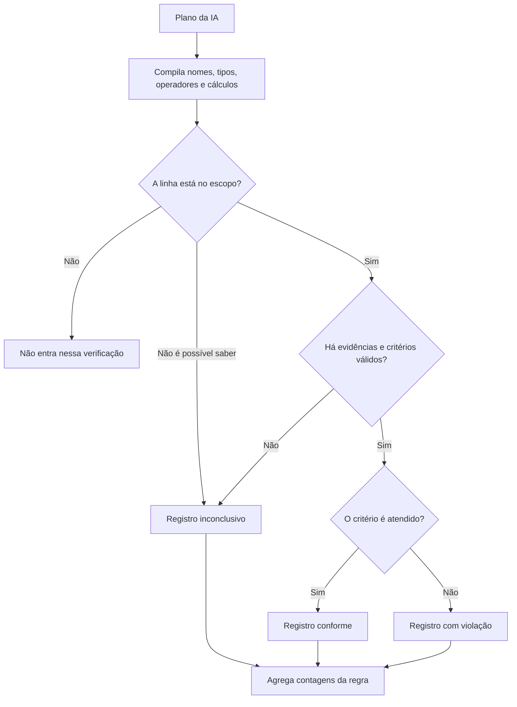

# Como a validação funciona

[Índice](README.md) · [Arquitetura](arquitetura.md) · [Fluxogramas](fluxos.md)

## Três operações diferentes

| Operação | Exemplo | Onde fica |
| --- | --- | --- |
| Revisão humana | A pessoa confirma que o trecho realmente representa uma regra. | `Rule.status` |
| Busca | Encontrar contratos cujo valor passa de 50.000. | `RuleQuery.query` e `state` |
| Verificação de cumprimento | Conferir se cada contrato aplicável possui garantia de pelo menos 5%. | `Rule.validation` |

A revisão pode estar aprovada e os registros apresentarem violações. Uma busca pode
executar sem erro e retornar linhas que não cumprem a obrigação.

Uma regra criada manualmente começa sem resultado de conformidade. Mudanças no tipo
ou resumo invalidam o resultado anterior. Use “Validar todas as regras” para verificar
essas regras no próximo processamento. Aprovar a revisão sem mudar o conteúdo não
sobrescreve uma violação já observada.

## Exemplo do começo ao fim

Considere uma base chamada `contratos`:

| Contrato | Valor | Assinatura | Entrega | Garantia |
| --- | ---: | --- | --- | --- |
| A | 60000 | 2026-01-01 | 2026-01-11 | 5% |
| B | 80000 | 2026-01-01 | 2026-01-12 | 2% |
| C | 10000 | 2026-01-01 | célula vazia | célula vazia |

O documento contém duas regras:

1. Contratos acima de 50.000 exigem garantia de pelo menos 5%.
2. A entrega deve acontecer em até 10 dias corridos após a assinatura.

Os dados são ilustrativos. As interpretações semânticas abaixo representam o que o
motor precisa receber confirmado para concluir a verificação.

### Etapa 1: entender as colunas

O parser identifica `Assinatura` e `Entrega` como datas, `Valor` como número e
`Garantia` como texto contendo percentuais. A IA acrescenta significado, unidade,
evento, confiança e justificativa.

```json
{
  "meaning": "Data em que o contrato foi assinado",
  "semantic_type": "date",
  "event": "assinatura do contrato",
  "unit": null,
  "confidence": "high",
  "reason": "O nome da coluna e os exemplos identificam a assinatura do contrato."
}
```

Esse objeto fica em `Dataset.columns[i].semantic`. O tipo físico continua separado:
uma coluna de texto pode significar um percentual; uma coluna de data pode representar
assinatura, publicação ou vencimento. Essas datas não são intercambiáveis.

### Etapa 2: selecionar o escopo e definir o cumprimento

Para a primeira regra, o plano pode ser:

```json
{
  "explanation": "Conferir garantia mínima de 5% nos contratos acima de 50.000.",
  "missing_data": [],
  "datasets": [
    {
      "scope": {
        "dataset": "contratos",
        "logic": "and",
        "conditions": [
          {"column": "Valor", "op": "gt", "value": 50000}
        ]
      },
      "logic": "and",
      "checks": [
        {
          "left": {"kind": "percentage", "column": "Garantia"},
          "op": "gte",
          "right": {"kind": "literal", "value": 5},
          "explanation": "Garantia deve ser de pelo menos 5%."
        }
      ]
    }
  ]
}
```

O escopo seleciona A e B. O critério compara o percentual: A é conforme, B apresenta
violação. C está fora do escopo dessa regra. Selecionar apenas os contratos com garantia
baixa no escopo esconderia os registros conformes e confundiria busca com verificação.

Para a segunda regra:

```json
{
  "explanation": "Comparar a entrega com o prazo de 10 dias corridos após a assinatura.",
  "missing_data": [],
  "datasets": [
    {
      "scope": {"dataset": "contratos", "logic": "and", "conditions": []},
      "logic": "and",
      "checks": [
        {
          "left": {
            "kind": "days_between",
            "column": "Assinatura",
            "other_column": "Entrega"
          },
          "op": "lte",
          "right": {"kind": "literal", "value": 10},
          "explanation": "Intervalo entre assinatura e entrega deve ser de até 10 dias."
        }
      ]
    }
  ]
}
```

A diferença de 1º a 11 de janeiro é de 10 dias: A é conforme. B tem 11 dias e apresenta
violação. C é inconclusivo porque falta a data de entrega. O motor não inventa essa data
nem conclui atraso apenas por uma célula vazia.

### Etapa 3: calcular e agregar



O resultado da regra de garantia tem 2 registros avaliados, 1 conforme e 1 com violação.
O resultado da regra de prazo tem 3 avaliados, 1 conforme, 1 com violação e 1 inconclusivo.

A conclusão geral de cada uma é `violacao`, pois existe uma violação observada.
Isso não transforma os registros inconclusivos em violações.

## Resultado geral e prioridade

A ordem de decisão em `compliance.summarize` é:

1. Havendo registro com violação, o resultado é `violacao`.
2. Havendo evidência faltante, incerteza, erro de critério ou nenhuma base avaliada,
   o resultado é `inconclusiva`.
3. Havendo plano válido mas nenhum registro aplicável, é `nao_aplicavel`.
4. Com registros avaliados e sem falhas ou incertezas, é `conforme`.

O coordenador também pode produzir `erro`, `desatualizada` e `ignorada`.

| Resultado | Leitura |
| --- | --- |
| `conforme` | Os registros avaliados atendem aos critérios, sem incerteza identificada. |
| `violacao` | Pelo menos um registro avaliado não atende. |
| `inconclusiva` | Faltam fatos, interpretação confirmada ou um critério executável. |
| `nao_aplicavel` | Não há registros aplicáveis no escopo válido. |
| `erro` | A geração ou execução não pôde ser concluída normalmente. |
| `desatualizada` | As fontes mudaram ou há bases que impedem uma conclusão atual. |
| `ignorada` | A pessoa rejeitou a regra na revisão humana. |

`applicable_count` conta as linhas avaliadas, incluindo aquelas potencialmente
aplicáveis cujo escopo é incerto. `passed_count`, `failed_count` e `unknown_count`
dividem essas linhas pelos resultados. A contagem não representa todas as linhas da
análise quando o escopo exclui registros.

## Cálculos permitidos

| Operando | Uso |
| --- | --- |
| `column` | Valor tipado de uma coluna. |
| `literal` | Valor de comparação; escalar ou lista, conforme o operador. |
| `days_between` | Diferença em dias corridos entre duas colunas de datas compatíveis. |
| `deadline` | Data inicial acrescida de quantidade inteira em dias, meses ou anos. |
| `percentage` | Percentual como `5%`, comparado na escala 5. |
| `ratio_percent` | 100 × numerador ÷ denominador, usando duas colunas numéricas. |
| `today` | Data de referência da avaliação, apenas quando o plano usa essa operação. |

Os operadores de comparação são os definidos em
[schemas/queries.py](../backend/app/schemas/queries.py). Não há SQL, `eval` ou
expressões livres do modelo. Comparações de uma expressão consigo mesma e cálculos
que usam a mesma coluna como as duas fontes são recusados.

Meses e anos respeitam a duração do mês de destino: um prazo iniciado em 31 de janeiro
não pode produzir 31 de fevereiro. Datas invertidas, números inválidos e divisão por
zero não viram provas de cumprimento.

## Evidência insuficiente e lógica de três valores

Cada critério pode produzir verdadeiro, falso ou desconhecido. Em uma combinação AND,
uma falha conhecida basta para o resultado falso; sem falha, um desconhecido impede
concluir verdadeiro. Em OR, um verdadeiro conhecido basta; sem ele, o desconhecido
impede concluir falso.

Uma coluna referenciada sem confiança semântica alta impede concluir a verificação.
Se a dúvida está no escopo, as linhas não são descartadas silenciosamente como
não aplicáveis. O resultado informa a razão da incerteza.

A existência de uma célula preenchida não prova que uma obrigação inteira foi
cumprida. O plano precisa representar a regra integralmente; partes não verificáveis
devem aparecer em `missing_data`.

## Dias úteis e critérios que dependem de outros dados

O motor atual não recebe um calendário de feriados e não implementa joins entre bases.
Por isso, não converte dias úteis em dias corridos e não presume feriados ou localidade.

Se a base já possui uma duração numérica explicitamente interpretada em dias úteis,
esse valor pode ser comparado diretamente com o limite. Sem essa evidência, prazos em
dias úteis ficam inconclusivos. Regras qualitativas, como sigilo sem qualquer
comprovação nos dados, também podem ficar inconclusivas.

## Persistência, versões e paginação

`Rule.validation` guarda o resultado público e dois campos internos: `_plan` e
`_sources`. Eles permitem reproduzir as comparações com a mesma data de referência
e conferir se as bases continuam correspondendo à avaliação.

A assinatura inclui situação da base, tamanho guardado, tamanho original e metadados
das colunas. Atualizar a interpretação de uma coluna também pode invalidar resultados,
mesmo que os bytes do CSV não tenham mudado.

As evidências de todas as linhas não são gravadas como novas linhas SQL. Ao paginar,
o serviço reproduz o plano sobre a base carregada e devolve a página solicitada.
O filtro por resultado é aplicado antes da paginação.

Se o CSV foi cortado por limite do Storage, a avaliação cobre apenas a parte guardada
e informa essa limitação. Não há conclusão geral de conformidade de um arquivo completo
quando a cobertura conhecida é parcial.

## Arquivos para acompanhar o exemplo

1. [schemas/validation.py](../backend/app/schemas/validation.py): forma do plano e dos resultados.
2. [validation_llm.py](../backend/app/services/validation_llm.py): significado e plano propostos pela IA.
3. [rule_validation.py](../backend/app/services/rule_validation.py): coordenação, persistência e fontes.
4. [compliance.py](../backend/app/services/compliance.py): execução dos critérios.
5. [validation-details.tsx](../frontend/src/components/validation/validation-details.tsx): evidências na interface.
6. [test_compliance.py](../backend/tests/test_compliance.py) e
   [test_validation_api.py](../backend/tests/test_validation_api.py): exemplos executáveis.
